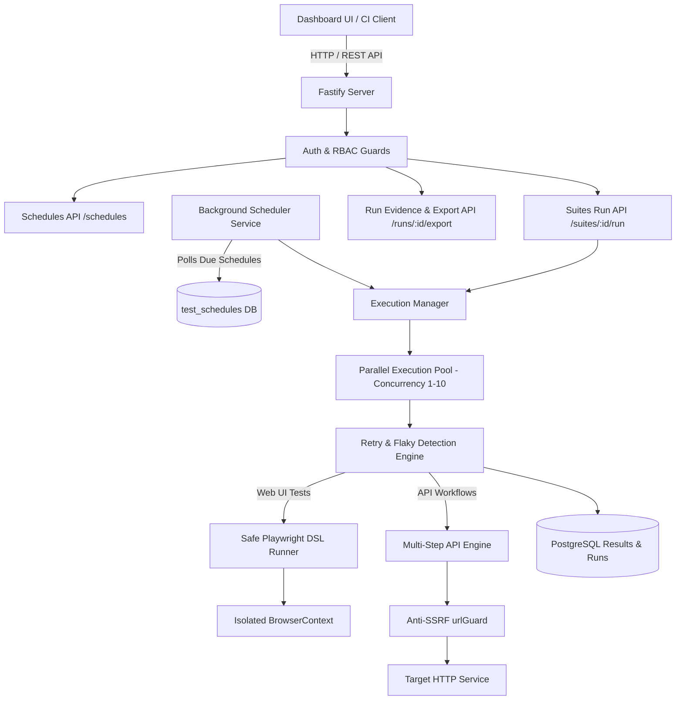

# TASK 8: Advanced Test Execution & Workflow Management

## 1. Overview & Architecture Enhancement

Task 8 upgrades the AI QA Testing Agent from individual, single-shot test executions into an enterprise-grade test automation and workflow execution platform. It introduces:

1. **Multi-Step API Testing Engine:** Chained HTTP workflows with runtime variable extraction (`extract: { token: "token", userId: "user.id" }`), dynamic parameter interpolation (`{{token}}`, `{{userId}}`), and multi-tier response assertions.
2. **Advanced Playwright Automation DSL:** Extended safe command grammar supporting explicit element & navigation waits, dropdown options, checkbox/radio toggles, screenshots, safe local fixture uploads, iframe element scoping, and dialog confirmation/dismissal.
3. **Isolated Parallel Execution Pool:** Configurable worker concurrency limits (1 to 10 workers) utilizing independent browser contexts (`browser.newContext()`) and zero-shared memory state.
4. **Autonomous Retries & Flaky Test Detection:** Configurable retry policies (0 to 5 attempts) with exponential backoff, recording individual attempt histories and isolating intermittent test flakiness from infrastructure errors without falsely passing inconclusive runs.
5. **Test Suite Scheduling Service:** Background scheduler worker with next-run calculation for hourly, daily, weekly, and 5-part cron schedules, lifecycle controls (pause/resume/edit/delete/run-now), execution history logging, and RBAC enforcement.
6. **Advanced Reporting & RFC 4180 Export:** Real-time dashboard visibility into flaky tests, retry attempts, step execution timelines, and standard RFC 4180 CSV & full JSON export endpoints (`/runs/:id/export`).



---

## 2. Multi-Step API Testing Engine

### 2.1 Workflow Concept
Rather than testing endpoints in total isolation, modern API validation requires executing sequential workflows such as:
`Login` → `Extract Token` → `Create Item` → `Extract Item ID` → `Update Item` → `Delete Item`.

### 2.2 Variable Extraction & Interpolation
- **Extraction Engine (`extractJsonValue`):** Extracts values from nested JSON structures using dot notation and array indexes (e.g., `user.profile.id`, `items.0.token`).
- **Template Interpolation (`interpolateTemplate`):** Automatically detects `{{variableName}}` markers within paths, headers, and request body payloads (including deeply nested objects and arrays) and substitutes values extracted from earlier steps.
- **Per-Step Assertions:** Each step independently validates HTTP status codes, latency thresholds (`max_response_ms`), expected fields (supporting nested dot-notation), and custom headers.

### 2.3 Example Multi-Step Workflow
```json
[
  {
    "name": "Authenticate",
    "method": "POST",
    "path": "/api/v1/auth/login",
    "body": { "email": "tester@example.com", "password": "SecretPassword123!" },
    "expected_status": 200,
    "extract": { "authToken": "token", "orgId": "user.organization_id" }
  },
  {
    "name": "Create Customer Record",
    "method": "POST",
    "path": "/api/v1/customers",
    "headers": { "Authorization": "Bearer {{authToken}}" },
    "body": { "name": "Acme Corp", "org_id": "{{orgId}}" },
    "expected_status": 201,
    "extract": { "customerId": "id" }
  },
  {
    "name": "Verify Created Customer",
    "method": "GET",
    "path": "/api/v1/customers/{{customerId}}",
    "headers": { "Authorization": "Bearer {{authToken}}" },
    "expected_status": 200,
    "expected_fields": { "name": "Acme Corp" }
  },
  {
    "name": "Clean Up Customer Record",
    "method": "DELETE",
    "path": "/api/v1/customers/{{customerId}}",
    "headers": { "Authorization": "Bearer {{authToken}}" },
    "expected_status": 204
  }
]
```

---

## 3. Advanced Playwright Automation DSL

The automation DSL in `src/services/runner.ts` and `src/services/automationConverter.ts` was expanded with rich, production-grade browser interaction capabilities while strictly enforcing security guarantees.

### 3.1 New DSL Commands
| Command Syntax | Description | Example |
|---|---|---|
| `wait <ms>` | Pauses execution for a designated duration (max 30,000ms). | `wait 1500` |
| `wait for selector <sel>` | Waits for target element to become visible in the DOM. | `wait for selector button#submit` |
| `wait for navigation` | Waits for the page load event following a submission or link click. | `wait for navigation` |
| `select <sel> | <val>` | Selects option in a dropdown element by value, label, or index. | `select select#country | US` |
| `check <sel>` | Checks a checkbox or radio button. | `check input#terms` |
| `uncheck <sel>` | Unchecks a checkbox input. | `uncheck input#newsletter` |
| `screenshot [name]` | Captures an on-demand named screenshot saved to artifact store. | `screenshot checkout-summary` |
| `upload <sel> | <filename>` | Uploads a safe local test fixture file to a file input. | `upload input[type='file'] | sample.pdf` |
| `frame <sel> | <sub_action>` | Executes safe sub-action inside an `<iframe>` container. | `frame iframe#payment | fill input#card | 4242` |
| `dialog accept [prompt]` | Automatically accepts browser alerts, confirms, or prompt dialogs. | `dialog accept Confirming order` |
| `dialog dismiss` | Automatically dismisses browser alert/confirm dialogs. | `dialog dismiss` |

### 3.2 Security Whitelist Enforcement
Arbitrary AI-generated JavaScript (`page.evaluate(...)`), `eval()`, and shell commands are strictly forbidden and blocked. Every step is parsed through `validateAutomationInstructions`:
1. Only whitelisted verbs (`open`, `click`, `fill`, `select`, `check`, `uncheck`, `expect`, `wait`, `screenshot`, `upload`, `frame`, `dialog`) are allowed.
2. File uploads are validated to ensure the fixture path resides inside the designated test fixtures directory; path traversal attacks (`../`) are rejected immediately.
3. Element selectors must not contain script injection vectors.

---

## 4. Parallel Test Execution & Resource Isolation

### 4.1 Concurrency Pool Architecture (`src/services/executionManager.ts`)
- Configurable worker limits from `1` (strict sequential) to `10` (parallel execution).
- Each parallel worker operates in an isolated worker promise loop pulling from a synchronized task queue.
- Browser executions create an independent browser context (`await browser.newContext()`) with separate cookies, local storage, session storage, and cache, guaranteeing zero cross-contamination between parallel tests.
- Workflows that have interdependencies (such as multi-step API chains) run sequentially within their worker thread, preserving execution order.

---

## 5. Automatic Retry & Flaky Test Detection

### 5.1 Retry Policies
- Configurable retry count (0 to 5 retries) per execution suite or schedule.
- When a test fails on an assertion or timeout, the execution manager re-executes the test with an exponential backoff.
- Each attempt is recorded with its own timestamp, duration, error message, and status in the `attempts` JSON column.

### 5.2 Flaky vs Infrastructure Error Classification
- **Flaky Test:** If a test fails on attempt 1 but passes on attempt 2 or 3, it is classified as `flaky: true`. The overall suite notes the flakiness while keeping test passes intact.
- **Genuine Failure:** If a test fails all allocated retry attempts, it is recorded as `status: "failed"`.
- **Infrastructure Error:** Network aborts, proxy disconnects, or browser process crashes are categorized as `status: "inconclusive"`. Inconclusive runs are never masked or automatically marked as passed.

---

## 6. Test Suite Scheduling Service

### 6.1 Background Scheduler Daemon (`src/services/scheduler.ts`)
- `startScheduler(intervalMs = 60_000)`: A background scheduler running every minute that queries `test_schedules` for active schedules where `next_run_at <= NOW()`.
- Prevents duplicate executions by locking running jobs and computing `next_run_at` based on frequency:
  - `hourly`: Current time + 1 hour.
  - `daily`: Current time + 24 hours.
  - `weekly`: Current time + 7 days.
  - `cron`: Next occurrence calculated using standard 5-part cron syntax (`minute hour day month day-of-week`).

### 6.2 Schedule REST API (`src/routes/schedules.ts`)
| Method | Endpoint | Role Required | Description |
|---|---|---|---|
| `POST` | `/projects/:projectId/schedules` | `qa_engineer`, `qa_manager`, `admin` | Create a new test execution schedule. |
| `GET` | `/projects/:projectId/schedules` | `viewer`+ | List all configured schedules for the project. |
| `GET` | `/schedules/:id` | `viewer`+ | Retrieve details of a schedule. |
| `PATCH` | `/schedules/:id` | `qa_engineer`+ | Update schedule config, pause, or resume. |
| `DELETE` | `/schedules/:id` | `qa_engineer`+ | Delete a schedule. |
| `POST` | `/schedules/:id/run-now` | `qa_engineer`+ | Trigger immediate execution of a scheduled suite. |
| `GET` | `/schedules/:id/runs` | `viewer`+ | Retrieve historical execution records. |

---

## 7. Execution Evidence & RFC 4180 Export API

### 7.1 Export Formats (`/runs/:id/export?format=csv|json`)
- **JSON Format:** Full hierarchical JSON representation including suite metadata, test items, step results, retry attempts, flaky flags, and timing metrics.
- **CSV Format:** Standard RFC 4180 CSV export with proper quotation and escaping.
  - Columns: `Test Type`, `Test Case / Endpoint ID`, `Title / Name`, `Module / Path`, `Status`, `Flaky`, `Attempts`, `Duration (ms)`, `Error Message`.

---

## 8. Verification & Test Coverage

### 8.1 Automated Test Suite
A dedicated automated test suite `src/__tests__/advancedExecutionAndWorkflows.test.ts` with 15 comprehensive unit and integration tests verifies all aspects of Task 8:
- Multi-step API variable extraction from nested JSON and arrays.
- Template string interpolation (`{{token}}`, `{{id}}`).
- Chained multi-step API workflows (Login → Create → Validate → Delete).
- Advanced Playwright DSL commands (`wait`, `select`, `check`, `uncheck`, `upload`, `dialog`, `frame`, `screenshot`).
- Parallel execution concurrency pooling.
- Flaky test detection and retry attempt tracking.
- Test schedule next run calculation (hourly, daily, weekly, cron).
- Schedule lifecycle management, RBAC, and history logging.
- RFC 4180 CSV and JSON run export endpoints.

### 8.2 Full Workspace Test Suite Results
```text
Test Files  22 passed (22)
     Tests  186 passed (186)
  Duration  21.03s
```
All 22 test files across Tasks 1 through 8 pass cleanly without regressions.

### 8.3 Build Results
- **Backend:** `npm run build` (`tsc`) exited with code 0 (zero TypeScript errors).
- **Dashboard:** `npm run build` in `dashboard/` (`tsc -b && vite build`) exited with code 0 (zero TypeScript or bundle errors).
